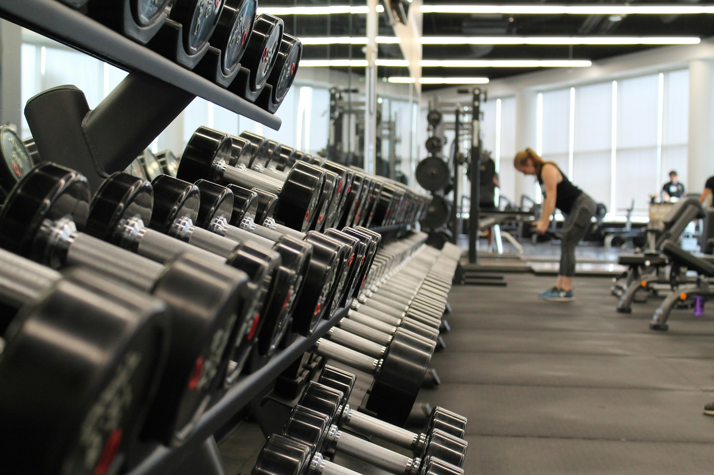

# 🏋️ IRON DISTRICT — Premium Gym Website

An award-level, cinematic, and responsive single-page gym website built with React, Vite, Tailwind CSS v4, GSAP, and Lenis.



## ✨ Highlights & Features

- **Cinematic Hero**: Dynamic split-character typography reveal, animated SVG brush underline, interactive chalk dust particle canvas, Ken Burns background effect, and mouse-parallax motion.
- **GSAP & Lenis Integration**: Butter-smooth inertial scrolling coupled with ScrollTrigger animations, staggered card reveals, and dynamic counter animations.
- **Award-Level Micro-Interactions**: Custom magnetic cursor with context-sensitive labels, neon flicker effects on CTA banners, and smooth card scaling.
- **Responsive Architecture**: Pixel-perfect layout across desktop, tablet, and mobile with an interactive full-screen drawer menu.
- **Complete Design System**: Custom typography with *Bebas Neue*, *Oswald*, *Inter*, and *Permanent Marker*, paired with dark vignette aesthetics and high-contrast crimson accents.

---

## 🛠️ Tech Stack

- **Framework**: [React 19](https://react.dev/) + [Vite 8](https://vitejs.dev/)
- **Styling**: [Tailwind CSS v4](https://tailwindcss.com/)
- **Animation**: [GSAP 3](https://gsap.com/) + ScrollTrigger, [Framer Motion](https://www.framer.com/motion/)
- **Smooth Scroll**: [Lenis](https://lenis.darkroom.engineering/)
- **Icons**: [Lucide React](https://lucide.dev/)
- **Fonts**: `@fontsource/bebas-neue`, `@fontsource/oswald`, `@fontsource/inter`, `@fontsource/permanent-marker`

---

## 🚀 Getting Started

### 1. Clone the repository
```bash
git clone https://github.com/namantiwari26/iron-district.git
cd iron-district
```

### 2. Install dependencies
```bash
npm install
```

### 3. Run development server
```bash
npm run dev
```

### 4. Build for production
```bash
npm run build
```

---

## 📁 Project Structure

```
iron-district/
├── public/
│   ├── favicon.svg
│   └── images/
│       ├── hero/
│       ├── programs/
│       ├── cta/
│       └── avatars/
├── src/
│   ├── components/
│   │   ├── Preloader.jsx
│   │   ├── Cursor.jsx
│   │   ├── IronLogo.jsx
│   │   ├── Navbar.jsx
│   │   ├── Hero.jsx
│   │   ├── Stats.jsx
│   │   ├── Particles.jsx
│   │   ├── Marquee.jsx
│   │   ├── Programs.jsx
│   │   ├── Pricing.jsx
│   │   ├── Coaches.jsx
│   │   ├── Cta.jsx
│   │   ├── VideoModal.jsx
│   │   └── Footer.jsx
│   ├── data/
│   │   ├── content.js
│   │   └── images.js
│   ├── hooks/
│   ├── utils/
│   ├── App.jsx
│   ├── main.jsx
│   └── index.css
└── vite.config.js
```

---

## 📝 License
MIT
